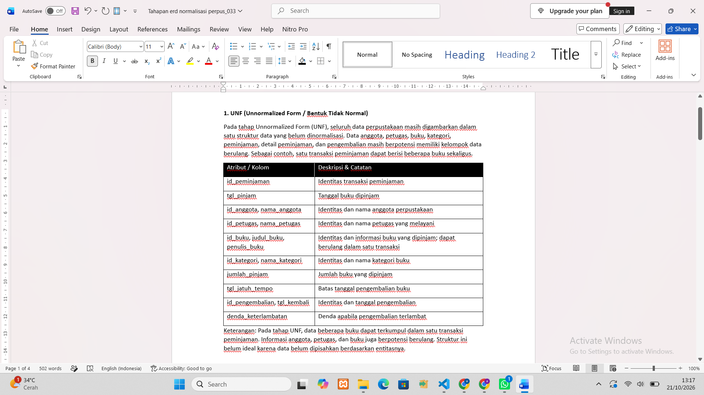

# LAPORAN PRAKTIKUM BASIS DATA – PERTEMUAN 4

**Nama:** Agis Sapitri  
**NPM:** 25430033  
**Kelas:** B  
**Tanggal:** 20 Oktober 2026  
**Nama Proyek:** Perpustakaan Nusa Cendekia (perpus_033)

---

## 1. Tujuan Praktikum

1. Memahami konsep normalisasi basis data dan manfaatnya dalam mengurangi redundansi serta mencegah anomali penyisipan, perubahan, dan penghapusan data.
2. Mengidentifikasi dependensi fungsional berdasarkan aturan bisnis dan kebutuhan data Perpustakaan Nusa Cendekia.
3. Menyusun tahapan normalisasi data mulai dari Unnormalized Form (UNF), First Normal Form (1NF), Second Normal Form (2NF), Third Normal Form (3NF), hingga memeriksa Boyce-Codd Normal Form (BCNF).
4. Memisahkan atribut ke dalam tabel yang sesuai berdasarkan dependensi fungsional dan hubungan antarentitas perpustakaan.
5. Menentukan Primary Key (PK), Foreign Key (FK), dan batasan unik (UNIQUE) pada skema relasional Perpustakaan Nusa Cendekia.
6. Menentukan keputusan penyimpanan nilai turunan agar data operasional tetap konsisten.
7. Menghasilkan skema relasional yang terstruktur sebagai dasar pembuatan tabel dan constraint pada praktikum berikutnya.

## 2. Ringkasan Dasar Teori

### 2.1 Pengertian Normalisasi

Normalisasi adalah proses menyusun dan memisahkan data ke dalam tabel-tabel terstruktur berdasarkan dependensi fungsional. Tujuannya adalah mengurangi redundansi data serta mencegah anomali penyisipan, perubahan, dan penghapusan data.

Pada Perpustakaan Nusa Cendekia, normalisasi diterapkan agar data anggota, petugas, buku, kategori buku, peminjaman, detail peminjaman, dan pengembalian disimpan pada tabel yang sesuai. Dengan demikian, informasi yang sama tidak perlu dicatat berulang kali pada banyak baris.

### 2.2 Anomali Data

Terdapat tiga jenis anomali yang dapat muncul apabila data disimpan dalam satu tabel besar yang tidak terstruktur.

- **Anomali penyisipan (Insertion Anomaly):** kesulitan menambahkan data baru karena harus menunggu data lain tersedia.
- **Anomali perubahan (Update Anomaly):** perubahan suatu informasi harus dilakukan pada banyak baris sehingga berisiko menimbulkan ketidakkonsistenan.
- **Anomali penghapusan (Deletion Anomaly):** penghapusan suatu data dapat menyebabkan informasi lain yang masih diperlukan ikut hilang.

Normalisasi membantu mengurangi ketiga anomali tersebut melalui pemisahan data berdasarkan entitas dan hubungannya.

### 2.3 Dependensi Fungsional

Dependensi fungsional merupakan hubungan antara atribut ketika suatu atribut atau kombinasi atribut menentukan tepat satu nilai atribut lainnya. Dependensi fungsional ditulis menggunakan simbol panah (→).

Contoh dependensi fungsional pada Perpustakaan Nusa Cendekia:

- `id_anggota → nama_anggota, alamat, no_telepon, email`
- `id_petugas → nama_petugas, username, password, no_telepon`
- `id_katagori → nama_katagori, deskripsi`
- `id_buku → judul_buku, pengarang, penerbit, tahun_terbit, id_katagori, stok_buku`
- `id_peminjaman → id_anggota, id_petugas, tanggal_peminjaman, tanggal_jatuh_tempo, status_peminjaman`
- `(id_peminjaman, id_buku) → jumlah_buku`
- `id_pengembalian → id_peminjaman, id_petugas, tanggal_pengembalian, denda`

Dependensi tersebut didasarkan pada asumsi bahwa setiap ID mengidentifikasi satu data secara unik dan satu pasangan peminjaman–buku hanya mempunyai satu baris rincian. Dependensi harus disesuaikan jika aturan bisnis atau struktur database aktual berbeda.

### 2.4 Tahapan Bentuk Normal

#### a. Unnormalized Form (UNF)

UNF merupakan bentuk data yang masih memungkinkan adanya kelompok data berulang. Contohnya, satu transaksi peminjaman mencatat beberapa buku dalam satu kelompok rincian.

#### b. First Normal Form (1NF)

1NF mensyaratkan setiap kolom berisi nilai atomik dan tidak memiliki kelompok berulang. Setiap baris rincian peminjaman mewakili satu buku dalam suatu transaksi.

#### c. Second Normal Form (2NF)

2NF mensyaratkan relasi telah memenuhi 1NF dan setiap atribut bukan kunci bergantung secara penuh pada seluruh kunci primer, bukan hanya sebagian dari kunci komposit.

Contohnya, data transaksi peminjaman dipisahkan dari rincian buku yang dipinjam. Informasi transaksi disimpan pada tabel `peminjaman`, sedangkan rincian buku disimpan pada tabel `detail_peminjaman`.

#### d. Third Normal Form (3NF)

3NF mensyaratkan relasi telah memenuhi 2NF dan tidak memiliki ketergantungan transitif atribut bukan kunci terhadap kunci primer.

Contohnya, informasi kategori buku disimpan pada tabel `katagori`, sedangkan tabel `buku` menyimpan `id_katagori` sebagai FK. Dengan demikian, nama kategori tidak perlu diulang pada setiap data buku.

#### e. Boyce-Codd Normal Form (BCNF)

BCNF mensyaratkan bahwa setiap penentu dalam dependensi fungsional nontrivial merupakan superkey. Pemeriksaan BCNF dilakukan berdasarkan dependensi fungsional dan aturan keunikan pada setiap tabel.

### 2.5 Skema Relasional

Skema relasional menggambarkan struktur tabel, atribut, dan hubungan antartabel dalam basis data.

Jenis kunci yang digunakan meliputi:

- **Primary Key (PK):** atribut atau kombinasi atribut yang mengidentifikasi setiap baris secara unik.
- **Foreign Key (FK):** atribut yang merujuk pada kunci di tabel lain untuk menjaga integritas hubungan data.
- **UNIQUE:** batasan yang memastikan nilai suatu atribut tidak berulang.

Pada Perpustakaan Nusa Cendekia, `id_anggota` menjadi PK pada tabel `anggota`, sedangkan `id_anggota` pada tabel `peminjaman` menjadi FK yang merujuk ke tabel `anggota`.

### 2.6 Keputusan Penyimpanan Nilai Turunan

Nilai turunan adalah nilai yang diperoleh melalui perhitungan atau pengolahan atribut lain. Keputusan untuk menyimpan atau menghitungnya perlu mempertimbangkan konsistensi data dan kebutuhan riwayat transaksi.

Pada Perpustakaan Nusa Cendekia, jumlah transaksi peminjaman dapat dihitung ketika laporan dibutuhkan. Sementara itu, nilai `denda` dapat disimpan pada tabel `pengembalian` agar nominal denda yang telah ditetapkan dalam riwayat transaksi tetap tersedia.

### 2.7 Kesimpulan Dasar Teori

Normalisasi membantu menghasilkan struktur basis data yang mengurangi redundansi, mencegah anomali, dan menjaga konsistensi data. Melalui analisis dependensi fungsional, tahapan UNF hingga 3NF, pemeriksaan BCNF, serta penentuan kunci dan nilai turunan, rancangan Perpustakaan Nusa Cendekia dapat disusun menjadi skema relasional yang lebih terstruktur.

## 3. Hasil Langkah Percobaan

### 3.1. Dari UNF ke 1NF
1. Tulis relasi spreadsheet lama dalam bentuk UNF. Satu nota menyimpan grup 
berulang barang:


2. Hilangkan grup berulang: satu baris untuk setiap barang di setiap nota. Kunci 
primer menjadi komposit (no_nota_penjualan, kode_barang).


### 3.2. Menuju 2NF dan 3NF
1. Bentuk 2NF


2. Bentuk 3NF


### 3.3 Mencocokkan dengan Skema Relasional

Skema relasional yang baik menggunakan PK untuk mengidentifikasi data secara unik, sedangkan FK digunakan untuk menghubungkan tabel yang berkaitan. Jika sistem menggunakan kode alami, seperti nomor anggota atau kode buku, keunikan kode tersebut dapat dijaga menggunakan `UNIQUE` sesuai aturan bisnis.

| Tabel | Kunci Primer (PK) | Kunci Unik (UNIQUE) | Kunci Tamu (FK) |
|---|---|---|---|
| `petugas` | `id_petugas` | `username` jika diwajibkan unik | – |
| `anggota` | `id_anggota` | `no_anggota` jika tersedia | – |
| `katagori` | `id_katagori` | `kode_katagori` jika tersedia | – |
| `buku` | `id_buku` | `kode_buku` jika tersedia | `id_katagori` |
| `peminjaman` | `id_peminjaman` | `no_transaksi_pinjam` jika tersedia | `id_anggota`, `id_petugas` |
| `detail_peminjaman` | `(id_peminjaman, id_buku)` | – | `id_peminjaman`, `id_buku` |
| `pengembalian` | `id_pengembalian` | Bergantung pada aturan bisnis | `id_peminjaman`, `id_petugas` |

Kolom seperti `no_anggota`, `kode_buku`, `kode_katagori`, dan `no_transaksi_pinjam` hanya digunakan apabila memang terdapat dalam database.

Pada tabel `pengembalian`, `id_peminjaman` tidak otomatis menjadi unik. Batasan `UNIQUE` baru diperlukan jika aturan perpustakaan menetapkan bahwa satu transaksi peminjaman hanya boleh memiliki satu catatan pengembalian.

#### Pemeriksaan BCNF (Boyce-Codd Normal Form)

Pemeriksaan BCNF dilakukan dengan memastikan setiap penentu dalam dependensi fungsional nontrivial merupakan superkey.

Berdasarkan rancangan yang digunakan:

- Tabel `anggota`: `id_anggota` menentukan atribut anggota.
- Tabel `petugas`: `id_petugas` menentukan atribut petugas.
- Tabel `katagori`: `id_katagori` menentukan atribut kategori.
- Tabel `buku`: `id_buku` menentukan atribut buku.
- Tabel `peminjaman`: `id_peminjaman` menentukan atribut transaksi.
- Tabel `detail_peminjaman`: pasangan `(id_peminjaman, id_buku)` menentukan `jumlah_buku`.
- Tabel `pengembalian`: `id_pengembalian` menentukan atribut pengembalian.

Dengan asumsi dependensi tersebut lengkap dan tidak ada aturan bisnis tambahan yang membuat atribut lain menjadi penentu, setiap tabel memenuhi pemeriksaan BCNF berdasarkan rancangan ini.


## 4. Jawaban Titik Analisis

### 4.1 Titik Analisis 1: Penyimpanan Jumlah Buku pada Detail Peminjaman

Atribut `jumlah_buku` disimpan pada tabel `detail_peminjaman` karena jumlah buku bergantung pada transaksi peminjaman dan buku yang dicatat dalam transaksi tersebut.

Dependensi fungsionalnya adalah:

`(id_peminjaman, id_buku) → jumlah_buku`

Satu buku dapat dipinjam dalam transaksi yang berbeda. Jumlah buku yang dipinjam juga dapat berbeda pada setiap transaksi. Oleh karena itu, `jumlah_buku` tidak tepat disimpan sebagai atribut tetap pada tabel `buku`.

Jika jumlah buku yang dipinjam disimpan pada tabel `buku`, sistem hanya dapat mencatat satu nilai jumlah untuk setiap buku, padahal jumlah tersebut berbeda-beda sesuai transaksi. Hal ini dapat menyebabkan informasi rincian peminjaman tidak akurat.

Dengan menyimpan `jumlah_buku` pada tabel `detail_peminjaman`, setiap transaksi dapat memiliki rincian jumlah buku yang sesuai tanpa mengubah data utama buku.

### 4.2 Titik Analisis 2: Keputusan Penyimpanan Denda Pengembalian

Keputusan menyimpan atau menghitung nilai denda bergantung pada kebutuhan sistem dan aturan bisnis perpustakaan.

Pada Perpustakaan Nusa Cendekia, nilai `denda` disimpan pada tabel `pengembalian` apabila sistem perlu mempertahankan nominal denda yang telah ditetapkan ketika buku dikembalikan.

Nilai denda dapat dihitung berdasarkan jumlah hari keterlambatan dan tarif denda yang berlaku. Namun, apabila tarif denda berubah pada masa mendatang, nominal denda untuk transaksi lama sebaiknya tetap menggambarkan nilai yang berlaku ketika denda ditetapkan.

Sementara itu, jumlah rekap peminjaman dapat dihitung dari data transaksi pada tabel `peminjaman` tanpa harus menyimpannya sebagai atribut tetap pada tabel anggota.

### 4.3 Titik Analisis 3: Pemisahan Data Kategori Buku

Informasi kategori buku disimpan pada tabel `katagori`, sedangkan tabel `buku` menyimpan `id_katagori` sebagai FK.

Dependensi fungsional yang digunakan adalah:

- `id_katagori → nama_katagori, deskripsi`
- `id_buku → judul_buku, pengarang, penerbit, tahun_terbit, id_katagori, stok_buku`

Apabila nama kategori disimpan langsung pada setiap baris tabel `buku`, nama yang sama dapat berulang pada banyak buku. Jika nama kategori berubah, beberapa baris buku harus diperbarui sehingga berisiko menimbulkan ketidakkonsistenan.

Dengan memisahkan kategori ke dalam tabel tersendiri, perubahan nama kategori cukup dilakukan satu kali pada tabel `katagori`. Tabel `buku` tetap terhubung melalui `id_katagori`.

## 5. Latihan dan Modifikasi

### 5.1 Normalisasi Nomor Telepon Anggota

Perpustakaan Nusa Cendekia dapat memiliki kebutuhan untuk mencatat lebih dari satu nomor telepon bagi seorang anggota. Jika beberapa nomor disimpan dalam satu kolom, nilai tersebut tidak lagi atomik sehingga tidak memenuhi prinsip 1NF.

Untuk mengatasi masalah tersebut, data nomor telepon dapat dipisahkan ke dalam tabel baru bernama `telepon_anggota`.

#### 1. Relasi Sebelum Normalisasi

```text
ANGGOTA(
    id_anggota (PK),
    nama_anggota,
    alamat,
    telepon_anggota
)
```

Jika `telepon_anggota` berisi beberapa nomor sekaligus, misalnya `081234567890, 082345678901`, maka satu kolom berisi lebih dari satu nilai.

#### 2. Relasi Setelah Normalisasi

Tabel `anggota`:

```text
ANGGOTA(
    id_anggota (PK),
    nama_anggota,
    alamat,
    email
)
```

Tabel `telepon_anggota`:

```text
TELEPON_ANGGOTA(
    id_anggota (PK, FK),
    nomor_telepon (PK)
)
```

Keterangan:

- `id_anggota` pada tabel `anggota` merupakan PK.
- `id_anggota` pada tabel `telepon_anggota` merupakan FK yang merujuk ke tabel `anggota`.
- Kombinasi `(id_anggota, nomor_telepon)` menjadi PK pada tabel `telepon_anggota`.
- Satu anggota dapat memiliki beberapa nomor telepon.
- Setiap nomor telepon disimpan dalam satu baris.

#### 3. Contoh Data

Tabel `anggota`:

| id_anggota | nama_anggota | alamat |
|---|---|---|
| A001 | jessen | Bandar Lampung |

Tabel `telepon_anggota`:

| id_anggota | nomor_telepon |
|---|---|
| A001 | 081234567890 |
| A001 | 082345678901 |

Dengan pemisahan tersebut, setiap nomor telepon disimpan sebagai nilai atomik. Data anggota juga tidak perlu diulang untuk setiap nomor telepon.

**Catatan:** Tabel `telepon_anggota` merupakan usulan modifikasi apabila sistem memang perlu menyimpan beberapa nomor telepon untuk satu anggota. Jika proyek aktual hanya menggunakan satu nomor telepon per anggota, tabel tambahan ini tidak harus dibuat.

### 5.2 Contoh Pelanggaran 3NF dan Anomali Perubahan

Apabila atribut `nama_anggota` disimpan langsung di tabel `peminjaman`, dapat terjadi redundansi karena nama anggota bergantung pada identitas anggota, bukan pada identitas transaksi peminjaman.

Dependensi fungsional yang relevan adalah:

- `id_peminjaman → id_anggota`
- `id_anggota → nama_anggota`

Dengan demikian, terdapat dependensi transitif:

`id_peminjaman → id_anggota → nama_anggota`

Jika `nama_anggota` disimpan pada tabel `peminjaman`, desain tersebut tidak memenuhi 3NF berdasarkan dependensi tersebut.

#### 1. Contoh Struktur Tabel yang Bermasalah

```text
PEMINJAMAN(
    id_peminjaman (PK),
    id_anggota,
    nama_anggota,
    tanggal_peminjaman,
    tanggal_jatuh_tempo
)
```

#### 2. Contoh Data yang Bermasalah

| id_peminjaman | id_anggota | nama_anggota | tanggal_peminjaman |
|---|---|---|---|
| P001 | A001 | jesen | 2026-10-01 |
| P002 | A001 | jesen | 2026-10-05 |
| P003 | A002 | agis | 2026-10-07 |

Nama jesen tercatat berulang pada dua transaksi. Jika nama anggota berubah, setiap baris peminjaman yang berkaitan harus diperbarui.

#### 3. Contoh Kueri SQL yang Menunjukkan Anomali Perubahan

```sql
-- Memeriksa data peminjaman anggota A001
SELECT id_peminjaman, id_anggota, nama_anggota
FROM peminjaman
WHERE id_anggota = 'A001';

-- Contoh perubahan pada struktur tabel yang bermasalah
UPDATE peminjaman
SET nama_anggota = 'jessen'
WHERE id_anggota = 'A001';

-- Memeriksa hasil perubahan
SELECT id_peminjaman, id_anggota, nama_anggota
FROM peminjaman
WHERE id_anggota = 'A001';
```

Kueri tersebut hanya merupakan ilustrasi untuk struktur yang belum dinormalisasi. Jangan menjalankannya pada database aktual apabila tabel `peminjaman` milikmu tidak memiliki kolom `nama_anggota`.

Pada struktur yang telah dinormalisasi, perubahan nama anggota dilakukan pada tabel `anggota`:

```sql
UPDATE anggota
SET nama_anggota = 'jesen'
WHERE id_anggota = 'A001';
```

Dengan demikian, nama anggota disimpan pada satu tempat dan seluruh transaksi tetap terhubung melalui `id_anggota`.

## 6. Tugas Mandiri. Milestone Proyek 4

1. dokumen sumber proyek (dari Pertemuan 2) sebagai titik awal UNF.
gmbr...
2. dependensi fungsional beserta kode AB yang mendasarinya.
gmbr...
3. tahapan 1NF, 2NF, 3NF, dan hasil pemeriksaan BCNF.
gmbr...
4. penyimpanan setiap nilai turunan beserta alasannya.
gmbr...
5. Perbarui ERD proyek bila berubah, dan catat perubahannya di 
p04_normalisasi_<NIM>.md.
gmbr...

## 7. Pembahasan dan Kendala

Pada Praktikum Basis Data Pertemuan 4, dilakukan proses normalisasi pada proyek Perpustakaan Nusa Cendekia. Proses ini bertujuan untuk menyusun data agar lebih terstruktur, mengurangi pengulangan informasi, dan menjaga konsistensi hubungan antartabel.

Tahapan normalisasi dimulai dengan mengidentifikasi bentuk data awal atau UNF, kemudian memisahkan kelompok data berulang agar memenuhi 1NF. Selanjutnya, pemeriksaan 2NF dilakukan untuk memastikan tidak terdapat ketergantungan parsial pada kunci komposit. Pada tahap 3NF, atribut dipisahkan berdasarkan dependensi fungsional untuk mengurangi ketergantungan transitif.

Rancangan perpustakaan terdiri dari tabel `anggota`, `petugas`, `katagori`, `buku`, `peminjaman`, `detail_peminjaman`, dan `pengembalian`. Setiap tabel memiliki fungsi yang berbeda dan saling berhubungan melalui PK dan FK.

Kendala yang dapat ditemukan dalam proses normalisasi adalah menentukan atribut yang sesuai untuk setiap tabel, membedakan data utama dengan data transaksi, serta menentukan dependensi fungsional dan kunci komposit. Selain itu, pemeriksaan BCNF memerlukan pemahaman mengenai penentu dan kunci kandidat pada setiap relasi.

Melalui proses ini, rancangan basis data diharapkan menjadi lebih mudah dikelola, mengurangi duplikasi, dan mendukung pengolahan data perpustakaan secara konsisten.

## 8. Kesimpulan

Berdasarkan Praktikum Basis Data Pertemuan 4, dapat disimpulkan bahwa normalisasi merupakan proses penting dalam perancangan basis data untuk mengurangi redundansi dan mencegah anomali penyisipan, perubahan, serta penghapusan data.

Pada proyek Perpustakaan Nusa Cendekia, normalisasi dilakukan dengan memisahkan data anggota, petugas, kategori, buku, peminjaman, detail peminjaman, dan pengembalian ke dalam tabel yang sesuai. Setiap tabel memiliki PK sebagai identitas data, sedangkan FK digunakan untuk menjaga hubungan antartabel.

Dependensi fungsional digunakan sebagai dasar penentuan struktur tabel. Pemeriksaan 1NF, 2NF, dan 3NF membantu menghasilkan struktur relasional yang lebih terorganisasi. Pemeriksaan BCNF juga diperlukan untuk memastikan bahwa setiap penentu dalam dependensi fungsional nontrivial merupakan superkey.

Dengan demikian, hasil normalisasi menjadi dasar yang lebih baik untuk pengembangan database Perpustakaan Nusa Cendekia, terutama dalam pengelolaan data buku, anggota, transaksi peminjaman, dan pengembalian.

## 9. Pernyataan Penggunaan AI

Dengan ini saya menyatakan bahwa saya menggunakan bantuan Artificial Intelligence (AI) sebagai alat bantu dalam memahami konsep normalisasi basis data, menyusun dokumentasi, dan memeriksa rancangan tabel. Saya tetap bertanggung jawab atas pemeriksaan, pemahaman, dan kebenaran seluruh isi laporan serta kesesuaiannya dengan hasil praktikum yang saya kerjakan.

## 10. Bukti Git
* Link Repositori: [https://github.com/agissapitri409-cloud/basisdata_25430033]

---
