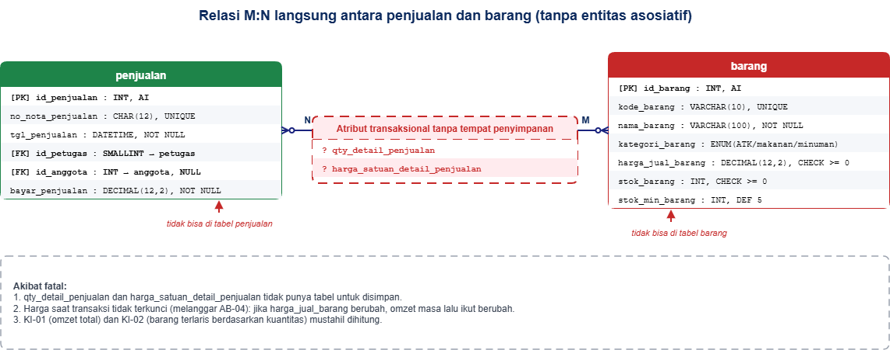
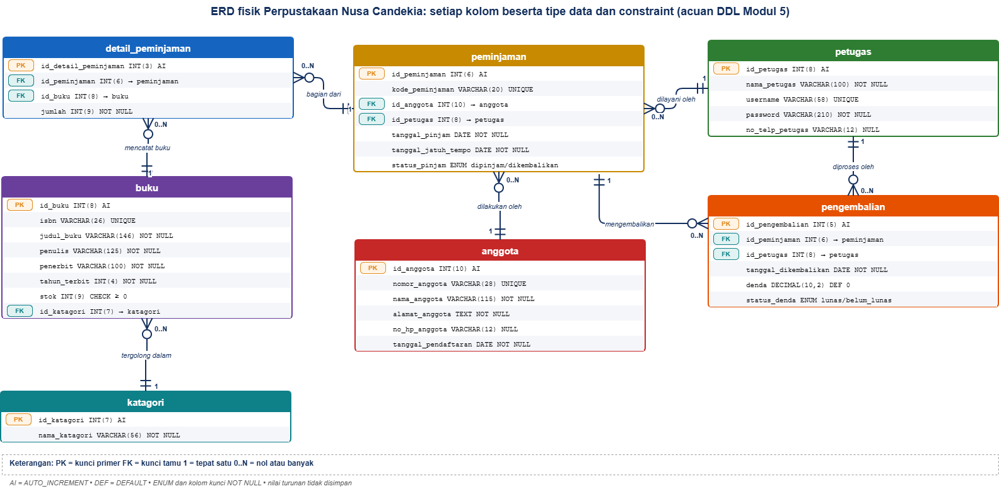

# Laporan Praktikum Basis Data - Pertemuan 03
**Nama:** Agis Sapitri  
**NIM:** 25430033  
**Kelas:** B  
**Tanggal:** 13 Oktober 2026  
**Proyek Basis Data:** Perpustakaan Nusa Cendekia (perpus_nusa_cendekia_033 / perpus_033)

---

## 1. Tujuan Praktikum
Pada praktikum Pertemuan 03 ini, saya mempelajari serta mempraktikkan proses perancangan basis data konseptual menggunakan *Entity-Relationship Diagram* (ERD)[cite: 54]. Adapun tujuan terukur dari praktikum ini meliputi:
1. Menguasai proses transformasi dokumen spesifikasi kebutuhan data (dari modul sebelumnya) menjadi gambar skema ERD konseptual secara runtut.
2. Melatih ketelitian dalam mengidentifikasi serta memisahkan entitas, atribut penjelas, atribut turunan, serta menentukan kunci utama (*Primary Key*), kunci alternatif (*Alternative Key*), dan kunci tamu (*Foreign Key*)[cite: 55].
3. Menentukan relasi logis antar-entitas beserta kardinalitas dan tingkat partisipasinya (seperti relasi *satu-ke-satu*, *satu-ke-banyak*, hingga *banyak-ke-banyak*) berdasarkan aturan bisnis (*Business Rules*) yang berlaku[cite: 55].
4. Mengatasi kendala pemodelan relasi *many-to-many* ($N:M$) dengan memecahnya ke dalam bentuk entitas asosiatif yang dilengkapi atribut transaksi mandiri[cite: 55].
5. Menggambarkan model ERD menggunakan notasi *Crow's Foot* pada platform draw.io sesuai standar kelengkapan diagram[cite: 57].
6. Memvalidasi dan menguji struktur ERD yang telah dibuat melalui penelusuran balik (*traceability*) terhadap daftar Kebutuhan Informasi (KI) untuk memastikan tidak ada informasi atau komponen data yang terlewat[cite: 59].

---

## 2. Ringkasan Dasar Teori
*Entity-Relationship Diagram* (ERD) adalah model perancangan konseptual yang merepresentasikan struktur data organisasi secara visual[cite: 54]. Komponen utama penyusun ERD terdiri atas:
* **Entitas:** Objek fisik maupun konseptual di dunia nyata yang datanya perlu dicatat dan disimpan ke dalam sistem[cite: 55].
* **Atribut:** Karakteristik atau sifat spesifik yang melekat pada suatu entitas[cite: 55]. Di dalam perancangan, dikenal pula *Primary Key* (sebagai pengenal unik baris data), atribut alternatif, serta atribut turunan (*derived attribute*) yang nilainya dapat dihitung langsung dari atribut lain sehingga tidak perlu disimpan secara permanen di dalam media penyimpanan fisik[cite: 55].
* **Relasi:** Hubungan bermakna yang terjalin antara dua entitas atau lebih, yang umumnya dibaca sebagai kata kerja[cite: 55].

Aspek krusial dalam pembuatan ERD menggunakan notasi *Crow's Foot* adalah pemahaman terhadap **kardinalitas** (jumlah maksimum kemunculan hubungan) dan **partisipasi** (sifat hubungan apakah wajib/mandatory atau opsional)[cite: 55]. Simbol-simbol pada ujung garis diagram (seperti garis tegak lurus, lingkaran kecil, atau cakar ayam) harus dibaca dengan cermat dari arah entitas seberangnya[cite: 55]. Penentuan kardinalitas ini mutlak bersumber dari aturan bisnis yang sah dan tidak boleh ditebak-tebak[cite: 55].

Selain itu, relasi *many-to-many* ($N:M$) tidak dapat diimplementasikan langsung ke dalam struktur tabel relasional karena akan memicu anomali serta hilangnya atribut khusus yang melekat pada kejadian relasi tersebut[cite: 55]. Oleh karena itu, relasi ini wajib dipecah menjadi dua relasi *one-to-many* ($1:N$) dengan menyisipkan sebuah **entitas asosiatif** di tengah-tengahnya (seperti tabel `detail_penjualan` yang memuat kuantitas dan harga satuan transaksi)[cite: 55, 56].

---

## 3. Hasil Langkah Percobaan

### D.1 Dari Entitas Kandidat ke Entitas (Studi Kasus Kopma)
Berdasarkan hasil pembedahan dokumen kebutuhan data Kopma, entitas kandidat "Pembelian dan detailnya" dipecah menjadi dua entitas terpisah, yakni `pembelian` dan `detail_pembelian`. Secara keseluruhan, terdapat delapan entitas utama yang dimodelkan:

| Entitas | Kunci Primer (*Primary Key*) | Kunci Alternatif (*Alternative Key*) | Kunci Tamu (*Foreign Key*) | Atribut Turunan |
|---|---|---|---|---|
| **petugas** | `id_petugas` | `kode_petugas` | - | - |
| **anggota** | `id_anggota` | `no_anggota`, `nim_anggota` | - | - |
| **barang** | `id_barang` | `kode_barang` | - | - |
| **penjualan** | `id_penjualan` | `no_nota_penjualan` | `id_petugas`, `id_anggota` | total nota |
| **detail_penjualan** | `id_penjualan` + `id_barang` | - | `id_penjualan`, `id_barang` | subtotal (`qty` $\times$ `harga_satuan`) |
| **pemasok** | `id_pemasok` | - | - | - |
| **pembelian** | `id_pembelian` | `no_faktur_pembelian` | `id_pemasok` | total faktur |
| **detail_pembelian** | `id_pembelian` + `id_barang` | - | `id_pembelian`, `id_barang` | - |

---

### D.2 Relasi dan Kardinalitas (Studi Kasus Kopma)

| Relasi | Sisi Kiri | Sisi Kanan | Dasar Aturan Bisnis |
|---|---|---|---|
| petugas melayani penjualan | Tepat satu petugas ($1$) | Nol atau banyak penjualan ($0..N$) | Wawancara kasir (Satu nota dicatat oleh satu kasir; kasir baru mungkin belum bertransaksi)[cite: 56] |
| anggota melakukan penjualan | Nol atau satu anggota ($0..1$) | Nol atau banyak penjualan ($0..N$) | **AB-02** (Pembeli umum boleh tanpa data anggota; anggota terdaftar dapat berbelanja berkali-kali)[cite: 56] |
| penjualan berisi detail_penjualan | Tepat satu penjualan ($1$) | Satu atau banyak detail ($1..N$) | **AB-01** (Setiap nota penjualan wajib memuat sekurang-kurangnya satu baris barang)[cite: 56] |
| barang tercantum di detail_penjualan | Tepat satu barang ($1$) | Nol atau banyak detail ($0..N$) | **AB-04** (Barang dalam katalog belum tentu langsung terjual)[cite: 56] |
| pemasok menerima pembelian | Tepat satu pemasok ($1$) | Nol atau banyak pembelian ($0..N$) | **AB-06** (Faktur pembelian berasal dari satu supplier; supplier dapat mengirim barang berkali-kali)[cite: 56] |
| pembelian berisi detail_pembelian | Tepat satu pembelian ($1$) | Satu atau banyak detail ($1..N$) | Faktur pemasok (Setiap faktur pembelian minimal mencantumkan satu jenis barang)[cite: 56] |

---

### D.3 Gambar ERD Kopma
.png>)

*Gambar D.3 Hasil erd kopma di draw.io.*

*Keterangan:* Diagram di atas merepresentasikan struktur ERD konseptual sistem Kopma yang mencakup 8 entitas dengan pembeda warna yang jelas antara entitas master dan entitas transaksional. Seluruh garis relasi telah menerapkan notasi *Crow's Foot* yang dilengkapi pelabelan kardinalitas angka serta kejelasan atribut kunci utama dan kunci tamu[cite: 57, 58]. Berkas sumber diagram disimpan dalam file `p03_erd_kopma_25430033.drawio`[cite: 57].

---

### D.4 Validasi Terhadap Kebutuhan Informasi (KI)

| Kode KI | Kebutuhan Informasi | Jalur Penelusuran pada ERD | Status |
|---|---|---|---|
| **KI-01** | Omzet total dan jumlah nota per hari/bulan | `penjualan` $\rightarrow$ `detail_penjualan`[cite: 59] | Valid[cite: 59] |
| **KI-02** | Lima barang terlaris per bulan berdasarkan kuantitas | `barang` $\rightarrow$ `detail_penjualan` $\rightarrow$ `penjualan` (difilter berdasarkan tanggal nota)[cite: 59] | Valid[cite: 59] |
| **KI-03** | Memantau barang yang berada di bawah stok minimum | Entitas `buku/barang` (memeriksa atribut `stok_barang` dan `stok_min_barang`)[cite: 59] | Valid[cite: 59] |
| **KI-04** | Sepuluh anggota dengan total belanja terbesar | `anggota` $\rightarrow$ `penjualan` $\rightarrow$ `detail_penjualan`[cite: 59] | Valid[cite: 59] |

*Kesimpulan Validasi:* Berdasarkan penelusuran di atas, seluruh Kebutuhan Informasi (KI) dapat dijawab melalui jalur relasi yang tersedia[cite: 59]. Hal ini membuktikan bahwa ERD Kopma tidak mengalami kekurangan entitas, atribut, maupun relasi[cite: 59].

---

## 4. Jawaban Titik Analisis

### Titik Analisis 1: Pemilihan `id_anggota` vs `NIM` sebagai Kunci Primer
`id_anggota` dipilih sebagai *Primary Key* karena nilainya dibangkitkan secara otomatis oleh sistem (*surrogate key*), bersifat netral, tidak bermakna semantik bisnis khusus, dan dijamin tidak akan pernah berubah. Di sisi lain, `NIM` merupakan data dunia nyata (*natural key*). Meskipun bernilai unik, NIM berisiko mengalami perubahan akibat kesalahan input saat pendaftaran awal atau adanya pemutakhiran data mahasiswa. Jika NIM dijadikan kunci primer, ketika terjadi perubahan atau koreksi NIM, pembaruan tersebut harus dilakukan secara *cascade* ke seluruh tabel anak yang merujuknya (seperti tabel `penjualan`), yang tentu berisiko merusak integritas data. Oleh karena itu, NIM cukup ditempatkan sebagai kunci alternatif (*Alternative Key*) dengan constraint `UNIQUE` guna memenuhi aturan bisnis **AB-05**, sedangkan `id_anggota` tetap bertindak sebagai kunci primer yang aman.

---

### Titik Analisis 2: Kardinalitas Penjualan ke Detail Bersifat Satu atau Banyak ($1..N$)
Aturan bisnis yang memaksanya adalah **AB-01**, yang menetapkan bahwa setiap nota transaksi penjualan wajib memuat minimal satu baris barang[cite: 56]. Kendati demikian, aturan batasan "minimal satu" ($1$) ini **tidak dapat ditegakkan sepenuhnya hanya melalui struktur fisik DDL tabel database secara otomatis**. Keberadaan `id_penjualan` sebagai *Foreign Key* di dalam tabel `detail_penjualan` secara mekanis hanya menjamin bahwa setiap baris detail tidak memiliki data yatim (*orphan record*), namun sebaliknya, server database secara struktur masih mengizinkan sebuah baris data dibuat di tabel `penjualan` tanpa menyertakan satupun baris rincian di `detail_penjualan`. Oleh karena itu, penjagaan aturan bisnis ini nantinya harus dibantu melalui mekanisme kontrol transaksi aplikasi (*Database Transaction*) yang akan dibahas pada Modul 14.

---

### Titik Analisis 3: Penambahan Petugas Gudang Penerima Barang pada Pembelian
ERD Kopma saat ini belum mampu menjawab kebutuhan terkait pencatatan petugas gudang penerima barang, karena relasi `petugas` sebelumnya hanya terikat pada entitas `penjualan`, sementara entitas `pembelian` baru menghubungkan antara `pemasok` dengan `detail_pembelian`. 

*Solusi Perancangan:* Kita perlu menambahkan relasi baru antara entitas `petugas` dan `pembelian` dengan membaca kalimat relasi: *"petugas mencatat/menerima pembelian"*. Kardinalitasnya adalah tepat satu petugas mencatat nol atau banyak pembelian ($1$ ke $0..N$), dengan menyisipkan kolom `id_petugas` sebagai *Foreign Key* di dalam tabel `pembelian`. Kebijakan ini melahirkan aturan bisnis baru, yaitu **AB-07** (*Setiap transaksi pembelian atau penerimaan barang dari pemasok wajib dicatat oleh tepat satu petugas yang memiliki peran bagian gudang*).

---

## 5. Hasil Latihan dan Modifikasi

### Latihan 1: Penerapan Poin Loyalitas Anggota
Poin loyalitas tidak tepat jika hanya diletakkan sebagai atribut sederhana di dalam entitas `anggota`. Poin sifatnya sangat fluktuatif: bertambah seiring transaksi belanja dan berkurang saat ditukarkan dengan potongan harga, sehingga riwayat mutasinya wajib terekam secara transparan untuk keperluan audit.

Oleh karena itu, dibuat entitas baru bernama `riwayat_poin` dengan struktur berikut:
* **Atribut:** `id_riwayat_poin` (PK), `id_anggota` (FK), `id_penjualan` (FK, opsional), `jenis_mutasi` (ENUM: 'TAMBAH'/'TUKAR'), `jumlah_poin`, dan `tanggal_mutasi`.
* **Relasi:** `anggota` ($1$) $\rightarrow$ `riwayat_poin` ($0..N$) dan `penjualan` ($1$) $\rightarrow$ `riwayat_poin` ($0..N$).
* **Aturan Bisnis Pendukung:** **AB-07** (Anggota memperoleh 1 poin setiap kelipatan Rp10.000 belanja) dan **AB-08** (50 poin dapat ditukar dengan potongan belanja senilai Rp5.000). Sesuai **AB-02**, fasilitas perolehan dan penukaran poin hanya berlaku eksklusif untuk anggota berstatus aktif.

---

### Latihan 2: Dampak Penghapusan Entitas Asosiatif pada Relasi Langsung
Jika relasi antara `penjualan` dan `barang` dihubungkan secara langsung dalam bentuk *many-to-many* ($N:M$) tanpa melalui entitas asosiatif, maka atribut transaksional yang melekat pada kejadian tersebut akan kehilangan tempat penyimpanan.

*Gambar latihan 1. hasil penjualan-barang tanpa entitas asosiatif di draw.io.*

**Akibat Fatal:**
1. Atribut penting seperti `qty_detail_penjualan` dan `harga_satuan_detail_penjualan` tidak bisa diletakkan di tabel `penjualan` maupun tabel `barang`.
2. Melanggar aturan **AB-04**: Harga satuan saat transaksi terjadi tidak dapat dikunci. Jika harga master barang berubah di masa mendatang, seluruh laporan omzet masa lalu ikut rusak dan berubah.
3. Kebutuhan Informasi seperti **KI-01** (perhitungan omzet total) dan **KI-02** (pencarian barang terlaris berdasarkan kuantitas) menjadi **mustahil untuk dihitung**[cite: 57].

---

## 6. Tugas Mandiri: Milestone Proyek 3
* **Tema Proyek Basis Data:** Perpustakaan Nusa Cendekia (`perpus_nusa_cendekia_033` / `perpus_033`)
* **Berkas Kerja:** `p03_erd_25430033.drawio` dan `p03_erd_25430033.png`

*Gambar Hasil erd perpustakaan di draw.io.*

### 6.1 Daftar Entitas Proyek
Sistem perpustakaan ini dibangun menggunakan 7 entitas utama:
1. `kategori` - Mengelompokkan jenis koleksi pustaka buku.
2. `buku` - Menyimpan katalog buku dan ketersediaan stok fisik.
3. `anggota` - Menyimpan data identitas peminjam perpustakaan.
4. `petugas` - Menyimpan data staf yang melayani transaksi sirkulasi.
5. `peminjaman` - Entitas kepala/header untuk mencatat transaksi peminjaman.
6. `detail_peminjaman` - Entitas asosiatif yang memecah relasi *many-to-many* antara peminjaman dan buku, serta menampung atribut jumlah buku.
7. `pengembalian` - Mencatat tanggal pengembalian fisik dan denda keterlambatan.

---

### 6.2 Relasi, Kardinalitas, dan Aturan Bisnis

| Relasi | Sisi Kiri | Sisi Kanan | Dasar Aturan Bisnis |
|---|---|---|---|
| kategori mengelompokkan buku | Tepat satu kategori ($1$) | Nol atau banyak buku ($0..N$) | **AB-04** (Satu buku masuk dalam 1 kategori; 1 kategori memuat banyak buku)[cite: 56] |
| anggota melakukan peminjaman | Tepat satu anggota ($1$) | Nol atau banyak peminjaman ($0..N$) | **AB-06** (Peminjaman dicatat atas 1 anggota; anggota bisa meminjam berulang kali)[cite: 56] |
| petugas mencatat peminjaman | Tepat satu petugas ($1$) | Nol atau banyak peminjaman ($0..N$) | **AB-05** (Sirkulasi dilayani oleh 1 petugas jaga)[cite: 56] |
| peminjaman berisi detail_peminjaman | Tepat satu peminjaman ($1$) | Satu atau banyak detail ($1..N$) | **AB-01** (Satu transaksi peminjaman minimal mencakup 1 buku)[cite: 56] |
| buku tercantum di detail_peminjaman | Tepat satu buku ($1$) | Nol atau banyak detail ($0..N$) | **AB-03** (Satu judul buku bisa dipinjam dalam berbagai transaksi berbeda)[cite: 56] |
| peminjaman diakhiri pengembalian | Tepat satu peminjaman ($1$) | Nol atau satu pengembalian ($0..1$) | **AB-08** (Satu transaksi peminjaman diakhiri oleh 1 data pengembalian)[cite: 56] |
| petugas memproses pengembalian | Tepat satu petugas ($1$) | Nol atau banyak pengembalian ($0..N$) | **AB-08** (Pengembalian diverifikasi oleh petugas perpustakaan)[cite: 56] |

*Catatan Desain:* Atribut `lama_keterlambatan` merupakan **atribut turunan** (dihitung dari selisih tanggal kembali dan tanggal jatuh tempo) sehingga tidak disimpan di database. Sebaliknya, nominal `denda` **wajib disimpan** karena tarif denda dapat berubah sewaktu-waktu sesuai kebijakan perpustakaan.

---

### 6.3 Pemetaan Entitas ke Proses Bisnis (PB) dan Kebutuhan Informasi (KI)

| Entitas Utama | Proses Bisnis (PB) Terkait | Kebutuhan Informasi (KI) Terkait |
|---|---|---|
| `anggota` | **PB-01** Pendaftaran Anggota Baru | **KI-04** Anggota Paling Aktif |
| `buku`, `kategori` | **PB-04** Pengelolaan Katalog Pustaka | **KI-02**, **KI-03** Stok Menipis |
| `peminjaman`, `detail_peminjaman` | **PB-02** Pencatatan Transaksi Peminjaman | **KI-01**, **KI-02**, **KI-04** |
| `pengembalian` | **PB-03** Pemrosesan Pengembalian & Denda | **KI-05** Rekapitulasi Keterlambatan & Denda |
| `petugas` | **PB-02**, **PB-03** Pelayanan Sirkulasi | - |

---

### 6.4 Penelusuran Kebutuhan Informasi (KI) ke Jalur ERD

| Kode KI | Deskripsi Kebutuhan Informasi | Jalur Penelusuran pada ERD | Status |
|---|---|---|---|
| **KI-01** | Jumlah total peminjaman buku per bulan | Entitas `peminjaman` (difilter berdasarkan `tanggal_pinjam`) | Terpenuhi[cite: 59] |
| **KI-02** | Lima buku terpopuler/tersering dipinjam per periode | `buku` $\rightarrow$ `detail_peminjaman` $\rightarrow$ `peminjaman` | Terpenuhi[cite: 59] |
| **KI-03** | Daftar buku dengan stok menipis atau habis | Entitas `buku` (memeriksa kolom `stok_buku` dan `stok_min`) | Terpenuhi[cite: 59] |
| **KI-04** | Anggota paling aktif melakukan peminjaman | `anggota` $\rightarrow$ `peminjaman` $\rightarrow$ `detail_peminjaman` | Terpenuhi[cite: 59] |
| **KI-05** | Rekapitulasi peminjaman terlambat beserta total denda | `peminjaman` $\rightarrow$ `pengembalian` (membaca kolom `denda`) | Terpenuhi[cite: 59] |

---

### 6.5 Catatan Tinjauan Klien / Peer Review

| No | Umpan Balik / Masukan dari Teman Sejawat | Keputusan | Alasan dan Tindakan Perbaikan |
|---|---|---|---|
| 1 | Sebaiknya tambahkan informasi kondisi fisik buku saat dikembalikan (apakah utuh, rusak, atau hilang). | Diterima | Ditambahkan atribut tambahan `kondisi_buku` pada entitas `pengembalian`. |
| 2 | Kenapa atribut nominal denda tidak langsung digabung ke dalam tabel peminjaman saja? | Ditolak | Peminjaman yang belum jatuh tempo atau belum dikembalikan belum memiliki nilai denda. Memisahkannya ke entitas `pengembalian` jauh lebih tepat secara normalisasi. |

---

## 7. Pembahasan dan Kendala Praktikum
* **Kesulitan Membaca Arah Kardinalitas:** Pada awalnya saya sempat terbalik dalam menempatkan simbol cabang *Crow's Foot* di draw.io. Setelah memahami kembali konsep dasarnya, saya menyadari bahwa cara membaca kardinalitas harus dilakukan dari arah entitas seberangnya (misalnya: *"untuk satu entitas A, berapa jumlah maksimum kemunculannya di entitas B?"*).
* **Kendala Berkas XML draw.io Terpotong:** Saat mengimpor kode XML diagram melalui menu *Extras > Edit Diagram*, sempat muncul galat *"Masukan tidak valid (error on line 129 at column 66: Premature end of data in tag mxCell)"*. Hal ini disebabkan oleh terpotongnya teks saat proses salin-tempel (*copy-paste*). Solusinya adalah menyalin ulang seluruh skrip secara utuh mulai dari tag `<mxGraphModel>` hingga penutup `</mxGraphModel>`.
* **Konsistensi Pemilihan Kunci:** Penggunaan ID buatan (`id_*`) sebagai kunci primer terbukti jauh lebih aman dan bersih dibandingkan menggunakan atribut dunia nyata seperti NIM atau kode teks yang rentan berubah sewaktu-waktu.

---

## 8. Kesimpulan
Pemodelan data menggunakan *Entity-Relationship Diagram* (ERD) memegang peran penting dalam menerjemahkan spesifikasi kebutuhan tekstual menjadi cetak biru visual yang terstruktur[cite: 54]. Notasi *Crow's Foot* membantu memperjelas batasan kardinalitas dan partisipasi relasi yang harus selalu bersumber secara akurat dari aturan bisnis organisasi[cite: 55]. Pemecahan relasi *many-to-many* menggunakan entitas asosiatif mutlak diperlukan untuk menampung atribut transaksional yang melekat[cite: 55]. Selain itu, validasi melalui penelusuran Kebutuhan Informasi (KI) memastikan bahwa rancangan model data yang dibuat telah memenuhi seluruh fungsi sistem secara komprehensif[cite: 59].

---

## 9. Pernyataan Penggunaan AI
Saya menggunakan bantuan AI sebagai alat bantu periksa logika, menyusun draf kerangka struktur laporan, dan membantu merapikan kode diagram draw.io. Seluruh hasil penelusuran Kebutuhan Informasi, perancangan aturan bisnis, jawaban titik analisis, serta catatan tinjauan klien telah saya periksa, telaah, dan sesuaikan secara mandiri sesuai dengan kondisi praktikum saya.

---

## 10. Bukti Git
* Link Repositori: [https://github.com/agissapitri409-cloud/basisdata_25430033]
* Tangkapan Layar Git Log / Commit:

